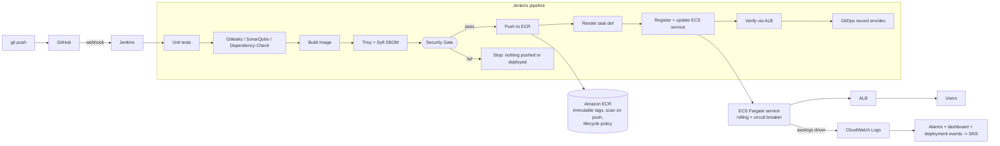

# Mod9 - Secure CI/CD Pipeline (ECS + SAST / SCA / Image Scan / SBOM / Secret Scan)

Hardens the Mod7 Flask CI/CD pipeline. Every build is scanned for code flaws, vulnerable dependencies, secrets
and image vulnerabilities, an SBOM is produced, and **any Critical/High finding or secret stops the pipeline
before an image reaches ECR or ECS**. A passing build pushes an immutable versioned image to ECR, renders and
registers a new ECS task definition revision, rolls the Fargate service onto it, and records what was deployed in Git (GitOps).

> **Status:** deployed and tested in a sandbox AWS account (eu-west-1). The pipeline has run green end to end (build #5:
> all security gates passed, image pushed to ECR, ECS service updated and verified through the ALB). Remaining work and
> evidence are tracked in `docs/LAB-LOG.md`.

## Lab progress
The lab is documented as it is done: see [`docs/LAB-LOG.md`](docs/LAB-LOG.md) for the step-by-step log, the issues found and
fixed, and the screenshot index (`docs/screenshots/`). Evidence from each build is stored under `evidence/`.

## Architecture

Infrastructure diagram with real AWS icons: `architecture.png` (rendered from `architecture.py` using the `diagrams` library).

## What maps to which lab requirement

| Lab requirement | Where it is |
| --- | --- |
| Same app, tests, Dockerfile, images in ECR | `app/` (Mod7 Flask API, hardened), `terraform/modules/ecr` |
| SAST | SonarQube - `scripts/sonar-scan.sh`, `sonar-project.properties`, Quality Gate `Secure-Gate` (`scripts/sonar-bootstrap.sh`) |
| SCA | OWASP Dependency-Check, fails at CVSS >= 7 - `scripts/dependency-check.sh` |
| Image scan | Trivy, fails on HIGH/CRITICAL with a fix available - `scripts/trivy-scan.sh` |
| Secret scan | Gitleaks over git history - `scripts/gitleaks.sh`, `security/.gitleaks.toml` |
| SBOM | Syft, CycloneDX + SPDX - `scripts/sbom.sh` -> `sbom/sbom.cdx.json` |
| Fail on Critical/High or secrets; archive reports | all scans run, then `secSecurityGate()` stops the build; `archiveArtifacts` keeps `reports/`, `sbom/`, `ecs/rendered/` |
| Versioned tags to ECR | `<build number>-<short sha>`, immutable repo, digest recorded - `scripts/ecr-push.sh` |
| Render + register task definition | `ecs/taskdef.template.json` -> `ecs/rendered/taskdef-<tag>.json` -> `scripts/ecs-deploy.sh register` |
| Update service (rolling) | `scripts/ecs-deploy.sh update/wait`; Terraform enables the deployment circuit breaker with automatic rollback |
| Logs to CloudWatch, alarms reflect the deployment | `awslogs` driver in the task definition; `terraform/modules/monitoring` (5xx rate, p95 latency, unhealthy targets, running tasks, CPU, ERROR logs, deployment events, dashboard) |
| Inject vulnerable dependency, then fix | `scripts/demo-inject-vuln.sh`, `scripts/demo-fix-vuln.sh` - see `docs/DEMO-RUNBOOK.md` |
| Clean up old images and revisions | ECR lifecycle policy (keep 10 tagged, expire untagged after 1 day) + `scripts/ecs-cleanup.sh` (keep 5 revisions) |
| Deliverables / evidence | `Jenkinsfile`, `ecs/`, `evidence/`, `docs/EVIDENCE-CHECKLIST.md` |

## Reuse from AOMS

The shared-library design and several step bodies follow `~/Projects/aoms/Jenkins-Shared-Libraries`:
`omsSecretScan` (containerised, redacted Gitleaks), `omsTrivyImageScan` (pipefail + report file, severity gate),
`omsDependencyScan` (OWASP DC with NVD key), `sonarQubeQualityGate`, `omsPushImageToECR`, and `armsGitopsDeploy`
(commit the image tag to Git, roll back with `git revert`). The AOMS pipelines use `withAWS(role:)` and Helm/Argo CD;
this lab uses the Jenkins instance profile and ECS, and has no company-specific names or credentials.
The library lives in `jenkins-shared-library/` (see its README for registering it in Jenkins).

## The pipeline (`Jenkinsfile`)

1. **Checkout** - sets `IMAGE_TAG=<build>-<sha7>`.
2. **Unit tests** - Dockerfile `test` stage runs pytest at build time.
3. **Code scans in parallel** - Gitleaks, SonarQube (waits for the Quality Gate), Dependency-Check. Each runs inside `catchError`, so all of them execute and every report is produced even if one fails.
4. **Build image** - non-root, gunicorn, no test tooling.
5. **Image scans in parallel** - Trivy (gating) and Syft (SBOM).
6. **Security Gate** - writes `reports/security-summary.md`; if any scan failed, the build stops here. Nothing has left Jenkins.
7. **Push to ECR** - immutable tag; the deployed image reference is pinned by digest.
8. **Render task definition** - validated (no unresolved placeholders, only keys ECS accepts).
9. **Deploy to ECS** - register revision, update service, wait for `COMPLETED`, then assert `/version` through the ALB equals the new tag.
10. **GitOps record** - commits the rendered task definition and `image.yaml` to the `env/dev` branch (orphan branch, never builds). Rollback: `git revert` there, then `scripts/ecs-deploy.sh rollback deployments/dev/taskdef.json`.
11. **Cleanup** (optional parameter) - deregisters old revisions.

## Setup (once) - fully scripted with Terraform and Ansible

Full commands: `docs/PROVISION-AND-TEST.md`. In short:
1. `terraform apply` in `terraform/environments/dev` - ECR, ECS, ALB, roles, log group, alarms, dashboard, Jenkins instance profile.
2. `ansible-playbook ansible/aws-prep.yml ...` - resizes the Jenkins EC2 host and disk, attaches the instance profile, sets IMDS hop limit 2, writes the inventory.
3. `ansible-playbook ansible/site.yml --ask-vault-pass` - installs and configures SonarQube (password, token, `Secure-Gate` gate, project) and Jenkins
   (Configuration as Code: admin user, credentials, shared library `secure-pipeline-lib` with Library Path `jenkins-shared-library`, the Multibranch job, GitHub webhook).
4. Push this repo to GitHub and scan the job.

Secrets live in an Ansible Vault file (`ansible/group_vars/all/vault.yml`, git-ignored) and reach Jenkins as files under `/run/secrets`.
`scripts/sonar-bootstrap.sh` is the manual equivalent of the SonarQube part, kept only as a fallback.
The scan, ECR and ECS scripts stay as scripts on purpose: Jenkins runs them on every build.

## Quality-gate policy

| Gate | Blocks when |
| --- | --- |
| Gitleaks | any secret in the repo history (values redacted in logs) |
| SonarQube `Secure-Gate` | any vulnerability, blocker or critical issue, security rating worse than A, hotspots not fully reviewed |
| Dependency-Check | any dependency with CVSS >= 7.0 |
| Trivy | any HIGH or CRITICAL with a fix available (`--ignore-unfixed`) |

No standing exceptions: `security/.trivyignore` and `security/dependency-check-suppressions.xml` are empty, and any entry added
needs a reason and an expiry. Unfixed OS-level findings are reported but do not block; remove `--ignore-unfixed` in
`scripts/trivy-scan.sh` for a stricter policy.

## Hardening already applied to the app

Fully pinned runtime dependencies (direct and transitive; `pip-audit` clean at authoring time), gunicorn instead of Flask's dev
server, non-root user, port 8080, pytest removed from the production image, read-only root filesystem and dropped Linux capabilities in the task definition, `/version` endpoint so the pipeline can prove which build is live.

## Known limits

- **Not yet run end to end** (see the status note at the top).
- Tasks run in public subnets with public IPs to avoid NAT cost; the security group only allows the ALB. A private-subnet variant needs a NAT gateway or VPC endpoints.
- The ALB is HTTP only; add an ACM certificate and an HTTPS listener for anything beyond the lab.
- Dependency-Check's first run downloads the NVD database; without an API key that can take 20+ minutes.
- Blue/green through CodeDeploy is optional in the lab and not implemented; rolling with the circuit breaker is.
- `latest` tags of the scanner images are used for convenience; pin them (`GITLEAKS_IMAGE`, `TRIVY_IMAGE`, `SYFT_IMAGE`, `DC_IMAGE`, `SONAR_SCANNER_IMAGE`) for reproducible builds.
- Destroy the lab when done: `terraform destroy` (ALB and Fargate tasks cost money while running).
